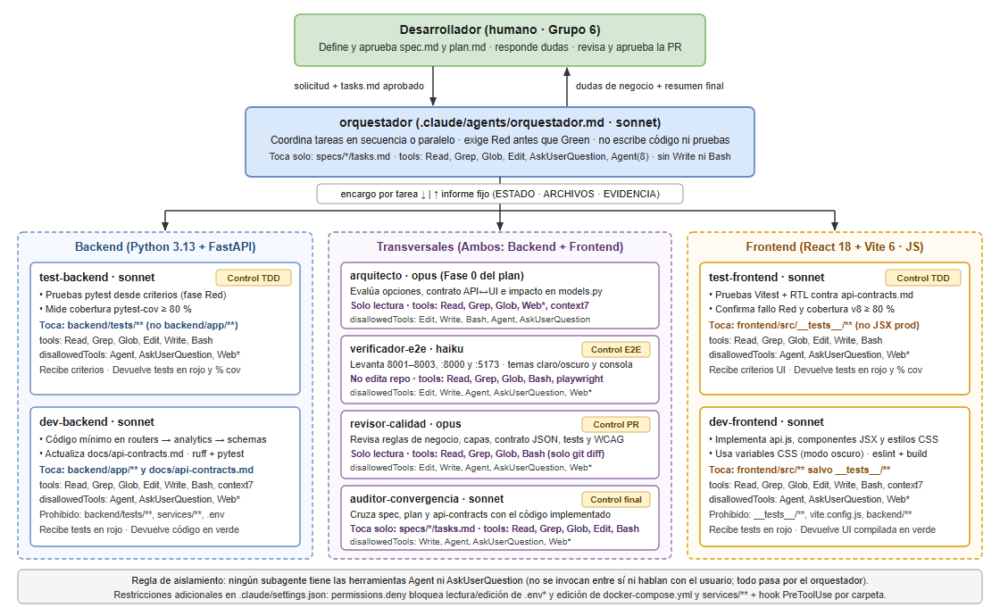
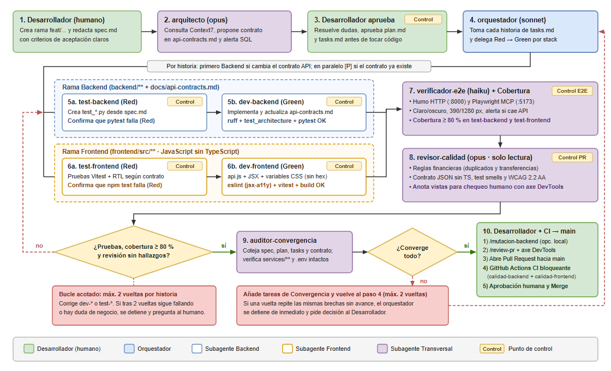

# Taller 5 · Sistema de agentes y aseguramiento de la calidad (FinanzIA)

**Diplomado en Ingeniería de Software con IA y Sistemas Agénticos · FET · Grupo 6**

- **Integrantes:** Angelo David Díaz Cortés · Andrés Ricardo Rodríguez Fernández · Elian Danilo Romero Herrera
- **Proyecto integrador (monorepo):** [angelodiaz2001/finanzIA](https://github.com/angelodiaz2001/finanzIA) (`backend/` en Python 3.13 + FastAPI + SQLAlchemy 2 y `frontend/` en React 18 + Vite 6 + Recharts, JavaScript sin TypeScript)
- **Herramienta del equipo:** Claude Code v2.1.318 (plan Claude Pro, terminal de VS Code en Windows con PowerShell)

---

## Entregables del taller

| Archivo | Descripción |
|---|---|
| [`Taller5_Grupo6_FinanzIA.pdf`](Taller5_Grupo6_FinanzIA.pdf) | **Documento de entrega para Q10** (5 páginas con tabla de agentes, diagramas, controles de calidad y diferencias con el sistema de referencia). |
| [`docs/sistema-agentes-finanzia.md`](docs/sistema-agentes-finanzia.md) | Versión en Markdown de las cuatro secciones del documento. |
| [`diagramas/01-estructura-agentes-finanzia.png`](diagramas/01-estructura-agentes-finanzia.png) | Diagrama de estructura del sistema único de agentes de FinanzIA (disponible también en [`.drawio`](diagramas/01-estructura-agentes-finanzia.drawio) y [`.svg`](diagramas/01-estructura-agentes-finanzia.svg)). |
| [`diagramas/02-flujo-solicitud-finanzia.png`](diagramas/02-flujo-solicitud-finanzia.png) | Diagrama de flujo de una solicitud con ciclo Red → Green, controles de calidad, bucles de máximo 2 vueltas y paso a `main` (en [`.drawio`](diagramas/02-flujo-solicitud-finanzia.drawio) y [`.svg`](diagramas/02-flujo-solicitud-finanzia.svg)). |

---

## Vista rápida de los diagramas

### 1. Estructura del sistema de agentes

### 2. Flujo de una solicitud y puertas de calidad

