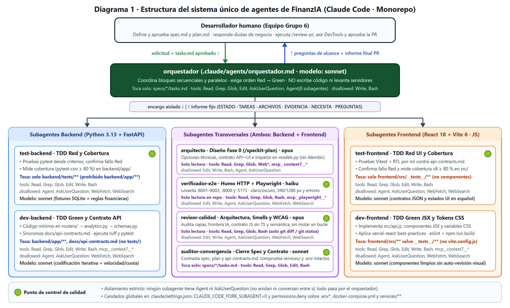
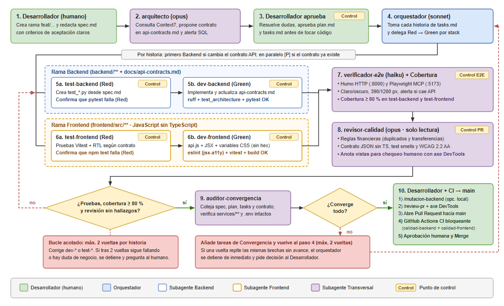

# Taller 5 · Sistema de agentes para su proyecto

**Diplomado en Ingeniería de Software con IA y Sistemas Agénticos · FET · Grupo 6 · Proyecto FinanzIA**  
*Angelo David Díaz Cortés · Andrés Ricardo Rodríguez Fernández · Elian Danilo Romero Herrera*

---

## 1. Proyecto y herramienta

- **Proyecto:** **FinanzIA** es una aplicación web de finanzas personales que consolida, normaliza y deduplica movimientos provenientes de tres APIs simuladas (banco, billetera digital y notificaciones SMS/correo), calcula indicadores con código determinista y los presenta en un panel interactivo con un asistente conversacional de IA que interpreta cifras sin calcularlas.
- **Herramienta declarada:** **Claude Code v2.1.318** (plan Claude Pro, ejecutado desde la terminal de VS Code en Windows con PowerShell). Los agentes se diseñan para `.claude/agents/*.md`, acompañados de `.claude/settings.json` (`CLAUDE_CODE_FORK_SUBAGENT=0` y bloqueos `permissions.deny`) y `.mcp.json` (servidores MCP `context7` y `playwright`).
- **Repositorio (monorepo público):** [https://github.com/angelodiaz2001/finanzIA](https://github.com/angelodiaz2001/finanzIA) — backend (**Python 3.13 + FastAPI + SQLAlchemy 2**) en [tree/main/backend](https://github.com/angelodiaz2001/finanzIA/tree/main/backend), frontend (**React 18 + Vite 6 + Recharts, JavaScript sin TypeScript**) en [tree/main/frontend](https://github.com/angelodiaz2001/finanzIA/tree/main/frontend), fuentes simuladas en [tree/main/services](https://github.com/angelodiaz2001/finanzIA/tree/main/services) y contrato compartido en [docs/api-contracts.md](https://github.com/angelodiaz2001/finanzIA/blob/main/docs/api-contracts.md).

---

## 2. Sistema de agentes

### 2.1. Un sistema único para el monorepo con subagentes especializados por stack

Diseñamos **un sistema único** para todo el monorepo en lugar de dos sistemas aislados. En FinanzIA cada funcionalidad completa cruza el repositorio de punta a punta: una consulta nueva en `backend/app/analytics.py` expone un esquema en `schemas.py`, obliga por regla de `CLAUDE.md` a actualizar en el mismo cambio `docs/api-contracts.md`, agrega el método HTTP en `frontend/src/api.js` y renderiza la vista en `frontend/src/components/`. Tener dos orquestadores separados duplicaría la gestión de `specs/*/tasks.md`, rompería la trazabilidad del contrato compartido e impediría levantar y probar juntos los cinco procesos locales (`scripts/start_all.ps1`: puertos 8001–8003, 8000 y 5173).

Al mismo tiempo, **evitamos usar un único programador o probador genérico**: separamos parejas TDD por stack (`test-backend` / `dev-backend` frente a `test-frontend` / `dev-frontend`) y dejamos transversales solo los roles que coordinan o auditan ambos lados (`orquestador`, `arquitecto`, `verificador-e2e`, `revisor-calidad` y `auditor-convergencia`). El backend requiere proteger cálculos financieros en Python/SQLite y aislar `ANTHROPIC_API_KEY`; el frontend carece de TypeScript, exige variables CSS para no romper el modo oscuro y demanda verificación visual y de accesibilidad en navegador real. Separarlos protege la ventana de contexto de cada subagente e impone **TDD estructural**.

### 2.2. Tabla de agentes del proyecto (Parte 1)

| Nombre y rol | Cuándo actúa | Qué recibe y qué entrega | Qué puede tocar | Herramientas y permisos (Claude Code) | Modelo y por qué |
|---|---|---|---|---|---|
| **`orquestador`** *(Orquestador · Ambos)* — Coordina fases e historias de `tasks.md`, aplica puntos de control y dialoga con el humano; no escribe código ni pruebas. | Al ejecutar la implementación de una spec aprobada, hasta cerrar todas sus tareas. Lo invoca el **desarrollador**. | **Recibe:** carpeta `specs/NNN-feature/` (`spec.md`, `plan.md`, `tasks.md`) y respuestas humanas. **Entrega:** `tasks.md` con `[X]`, traza de decisiones y tabla final para abrir la PR. | **Puede:** solo `specs/*/tasks.md`. **Prohibido:** `backend/**`, `frontend/**`, `services/**`, `docs/**` y `.env`. | `tools: Read, Grep, Glob, Edit, AskUserQuestion, Agent(arquitecto, test-backend, dev-backend, test-frontend, dev-frontend, verificador-e2e, revisor-calidad, auditor-convergencia)` · `disallowedTools: Write, Bash, WebFetch, WebSearch` | **`sonnet`**. Despacha bloques, evalúa informes estructurados y frena bucles (máx. 2 vueltas); exige rigor procedimental frecuente sin el costo ni la latencia de `opus` en cada turno. |
| **`arquitecto`** *(Subagente · Ambos)* — Investiga decisiones técnicas abiertas, evalúa cambios en `models.py` (sin Alembic) y diseña el contrato API↔UI. | En la Fase 0 de `/speckit-plan`, antes de crear tareas o tocar código. Lo invoca el agente de plan o el **`orquestador`**. | **Recibe:** `spec.md`, dudas técnicas abiertas y capas candidatas. **Entrega:** opciones con pros/contras, versiones verificadas, propuesta de contrato para `docs/api-contracts.md`, alerta SQL y preguntas al humano. | **Puede:** nada (solo lectura). **Prohibido:** crear o editar cualquier archivo; leer `.env`. | `tools: Read, Grep, Glob, WebSearch, WebFetch, mcp__context7__resolve-library-id, mcp__context7__query-docs` · `disallowedTools: Edit, Write, Bash, Agent, AskUserQuestion` | **`opus`**. Se invoca una sola vez por feature donde prima el juicio de diseño: cruzar invariantes financieros, respetar que la IA no calcule cifras y evitar sobreingeniería. |
| **`test-backend`** *(Subagente · Backend)* — Escribe pruebas `pytest` desde los criterios de aceptación antes del código (**Red**) y mide cobertura en `backend/app/`. | Antes de cada bloque Green del backend (modo Red) y en el punto de control de cobertura por historia. Lo invoca el **`orquestador`**. | **Recibe:** tareas Red de `tasks.md`, criterios de `spec.md` y contrato de `plan.md`. **Entrega:** `backend/tests/test_*.py`, matriz `criterio → prueba`, fallo Red comprobado o `%` de cobertura y líneas sin cubrir. | **Puede:** `backend/tests/**`. **Prohibido:** `backend/app/**`, `frontend/**`, `services/**`, `docs/**`, `pytest.ini` y `.env`. | `tools: Read, Grep, Glob, Edit, Write, Bash` · `disallowedTools: Agent, AskUserQuestion, WebFetch, WebSearch` *(Hook acota escritura a `backend/tests/**`).* | **`sonnet`**. Construye fixtures herméticos en SQLite en memoria (`db_session`, `monkeypatch`) y casos borde financieros (duplicados, transferencias, 400/422) con alta precisión y buen costo. |
| **`dev-backend`** *(Subagente · Backend)* — Escribe el código mínimo en FastAPI/SQLAlchemy para pasar las pruebas (**Green**), refactoriza y actualiza `docs/api-contracts.md`. | Tras confirmarse el fallo Red en `test-backend`, o al corregir hallazgos backend del revisor. Lo invoca el **`orquestador`**. | **Recibe:** tareas Green, pruebas en rojo de `backend/tests/` y `plan.md`. **Entrega:** cambios en `backend/app/`, contrato en `docs/api-contracts.md` y salida en verde de `ruff check` + `pytest`. | **Puede:** `backend/app/**`, `docs/api-contracts.md` (y `requirements.txt`/`.env.example` si el plan lo aprueba). **Prohibido:** `backend/tests/**`, `frontend/**`, `services/**`, `docker-compose.yml` y `.env`. | `tools: Read, Grep, Glob, Edit, Write, Bash, mcp__context7__resolve-library-id, mcp__context7__query-docs` · `disallowedTools: Agent, AskUserQuestion, WebFetch, WebSearch` *(Hook limita edición a `backend/app/**` y `docs/api-contracts.md`).* | **`sonnet`**. Codificación iterativa sobre capas claras (`routers/` → `analytics.py` → `schemas.py` y `tool_use` en `assistant.py`), maximizando velocidad y cuidando la cuota de 4 h de Claude Pro. |
| **`test-frontend`** *(Subagente · Frontend)* — Escribe pruebas de comportamiento con Vitest y Testing Library (**Red**) contra el contrato real y mide cobertura UI. | Antes de cada bloque Green de interfaz (modo Red) y al medir cobertura frontend de la historia. Lo invoca el **`orquestador`**. | **Recibe:** tareas Red UI, criterios de `spec.md` y `docs/api-contracts.md`. **Entrega:** `frontend/src/__tests__/*.test.jsx`, matriz `criterio → prueba`, evidencia de fallo Red en `npm test` o `%` de cobertura v8. | **Puede:** `frontend/src/__tests__/**` (y setup de Vitest previsto en el plan). **Prohibido:** componentes/CSS de producción en `frontend/src/**`, `backend/**`, `services/**` y `.env`. | `tools: Read, Grep, Glob, Edit, Write, Bash` · `disallowedTools: Agent, AskUserQuestion, WebFetch, WebSearch` *(Hook acota escritura a `frontend/src/__tests__/**`).* | **`sonnet`**. Traduce estados React (`range`, `version`, listas vacías, avisos `role="alert"`) y payloads reales de `api.js` a aserciones accesibles (clave al no tener TypeScript). |
| **`dev-frontend`** *(Subagente · Frontend)* — Implementa componentes JSX y estilos con variables CSS para pasar las pruebas (**Green**), siguiendo `vercel-react-best-practices`. | Tras confirmarse el Red en `test-frontend`, o para corregir hallazgos de UI/accesibilidad. Lo invoca el **`orquestador`**. | **Recibe:** tareas Green UI, pruebas en `__tests__/` y `docs/api-contracts.md`. **Entrega:** archivos JSX/CSS tocados y evidencia de `npm test`, `npm run lint`, `npm run build` y `0` colores hexadecimales en JSX. | **Puede:** `frontend/src/**` (salvo `__tests__/**`) y `frontend/index.html`. **Prohibido:** `frontend/src/__tests__/**`, `vite.config.js`, `package-lock.json` manual, `backend/**`, `services/**` y `.env`. | `tools: Read, Grep, Glob, Edit, Write, Bash, mcp__context7__resolve-library-id, mcp__context7__query-docs` · `disallowedTools: Agent, AskUserQuestion, WebFetch, WebSearch` *(Hook impide editar `__tests__/**`).* | **`sonnet`**. Escritura ágil de componentes de presentación, cargas paralelas `Promise.all` con bandera `cancelled` y CSS reutilizable, sin gastar contexto en levantar el navegador. |
| **`verificador-e2e`** *(Subagente · Ambos)* — Ejecuta pruebas de humo HTTP y validación visual/temas real levantando los servicios y Playwright MCP, sin permiso de edición. | Al cerrar las tareas de una historia que toque rutas HTTP o interfaz, antes de `revisor-calidad`. Lo invoca el **`orquestador`**. | **Recibe:** endpoints y vistas del alcance. **Entrega:** estado/cuerpo HTTP en `:8000` (200 y 400/422) y reporte de `:5173` (sincronizar fuentes, filtros de periodo, claro/oscuro, 390/1280 px, backend caído con `role="alert"` y `0` errores de consola). | **Puede:** nada en el repo (solo lectura; capturas efímeras en ruta ignorada). **Prohibido:** crear o modificar código, pruebas o documentos. | `tools: Read, Grep, Glob, Bash, mcp__playwright__browser_navigate, mcp__playwright__browser_snapshot, mcp__playwright__browser_click, mcp__playwright__browser_resize, mcp__playwright__browser_console_messages, mcp__playwright__browser_take_screenshot` · `disallowedTools: Edit, Write, Agent, AskUserQuestion, WebFetch, WebSearch` | **`haiku`**. Ejecuta un guion operativo repetitivo sobre 5 procesos locales y resume logs y árboles DOM extensos con baja latencia y ~10× menor consumo de cuota que `sonnet`. |
| **`revisor-calidad`** *(Subagente · Ambos)* — Audita con juicio de arquitecto reglas de negocio, arquitectura, contrato JSON sin TypeScript, *test smells* y semántica WCAG 2.2 AA. | En el punto de control de cada historia, en la revisión final y desde la skill local `/review-pr`. Lo invoca el **`orquestador`**. | **Recibe:** `git diff` del alcance, matriz de pruebas y reportes de cobertura/E2E. **Entrega:** hallazgos (`CRÍTICO`–`BAJO`) con `archivo:línea`, rol que corrige y vistas pendientes de pasar por **axe DevTools** humano. | **Puede:** nada (solo lectura). **Prohibido:** editar archivos o correr mutación pesada dentro del bucle. | `tools: Read, Grep, Glob, Bash` · `disallowedTools: Edit, Write, Agent, AskUserQuestion, WebFetch, WebSearch` *(`Bash` limitado a `git diff`/`git status`).* | **`opus`**. Detectar pruebas tautológicas, fugas de transferencias en totales o desajustes sutiles entre `schemas.py` y `src/api.js` exige el máximo nivel de razonamiento crítico. |
| **`auditor-convergencia`** *(Subagente · Ambos)* — Verifica al final que el código cumpla íntegramente `spec.md`, `plan.md`, `docs/api-contracts.md` y `tasks.md`. | Al cierre de `/speckit-implement`, cuando todas las tareas e incidencias están en `[X]`. Lo invoca el **`orquestador`**. | **Recibe:** `specs/NNN-feature/` y diff acumulado. **Entrega:** `converged` o `tasks_appended` tras cotejar requisito por requisito y confirmar que `services/**` y `.env` no fueron alterados. | **Puede:** añadir solo `## Fase N: Convergencia` al final de `specs/*/tasks.md`. **Prohibido:** editar código, pruebas, `spec.md` o `plan.md`. | `tools: Read, Grep, Glob, Edit, Bash` · `disallowedTools: Write, Agent, AskUserQuestion, WebFetch, WebSearch` *(Hook restringe `Edit` a `specs/*/tasks.md`).* | **`sonnet`**. Sigue la skill estructurada `speckit-converge` cruzando especificaciones y código; necesita mayor comprensión semántica que `haiku` sin requerir el costo de `opus`. |

> **Cómo se hacen efectivos los permisos en Claude Code:** combinamos **(1)** `tools` y `disallowedTools` en cada `.claude/agents/*.md` (ningún subagente recibe `Agent` ni `AskUserQuestion`), **(2)** `CLAUDE_CODE_FORK_SUBAGENT=0` y reglas globales `permissions.deny` en `.claude/settings.json` para `.env*`, `docker-compose.yml` y `services/**`, y **(3)** un hook determinista `PreToolUse` sobre `Edit|Write` que restringe cada agente escritor a su carpeta autorizada.

### 2.3. Diagramas de estructura y de flujo (Parte 2)

*Figura 1. Estructura del sistema único de agentes de FinanzIA: un orquestador con permisos acotados y ocho subagentes aislados por rol y carpeta.*

*Figura 2. Flujo de una solicitud de extremo a extremo en FinanzIA: TDD en backend y frontend, puertas de calidad, bucles limitados a 2 vueltas y aprobación humana + CI antes de `main`.*

---

## 3. Calidad del código

En FinanzIA, que el backend arranque y `npm run build` termine en verde no prueba que el software sea correcto: un modelo puede olvidar excluir envíos a personas (`SENT_TRANSFERS`) de un indicador de gasto, hacer que el LLM estime cifras en vez de consultar SQL, escribir una prueba que solo repite su propio fixture o consumir en React un campo JSON inexistente porque el frontend usa JavaScript sin TypeScript.

| Riesgo típico del código IA | Cómo se detecta en Backend (`backend/**`) | Cómo se detecta en Frontend (`frontend/**`) | Cuándo y evidencia | ¿Bloquea `main`? |
|---|---|---|---|---|
| **Pruebas vacías, tautológicas o acopladas al mock** | **TDD estructural:** `test-backend` escribe en `backend/tests/` desde `spec.md` y confirma fallo **Red** antes de `dev-backend`. `revisor-calidad` inspecciona *test smells*. Fuera del bucle, **`mutmut`** muta `analytics.py`, `dedup.py`, `categorizer.py` y `normalizer.py`. | **TDD estructural:** `test-frontend` crea `*.test.jsx` (Vitest + RTL por rol/texto accesible, sin snapshots) y confirma **Red** antes de `dev-frontend`. `revisor-calidad` rechaza pruebas sin `expect`, solo-mock o atadas a clases CSS. | En cada historia (informe Red + matriz `criterio → prueba`); `mutmut` antes de PR y en job CI de la PR (JSON de supervivientes). | **Sí** (fallo de tests en CI). Mutación es **informativa**. |
| **APIs, librerías o campos JSON inventados** | Consulta en **Context7 MCP** para FastAPI, SQLAlchemy 2, Pydantic v2 y SDK de Anthropic; validación con `ruff`, `pytest` y humo HTTP de `verificador-e2e`. | `dev-backend` fija `docs/api-contracts.md`, `test-frontend` simula `src/api.js` con ese esquema exacto, `revisor-calidad` cruza `schemas.py` ↔ `api-contracts.md` ↔ `api.js` y `verificador-e2e` prueba `:5173` contra `:8000` real. | Durante Green, humo E2E (respuestas 200/400/422 y consola limpia) y job CI de build/lint/tests. | **Sí** (lint, tests y build bloquean en CI). |
| **Código muerto, no verificado o sobreingeniería** | Cobertura **≥ 80 %** con `pytest-cov` sobre `backend/app/`. El `orquestador` revisa líneas con `0` ejecuciones para exigir prueba o eliminar código sobrante. | Cobertura **≥ 80 %** con `@vitest/coverage-v8` sobre `frontend/src/`. `revisor-calidad` penaliza efectos redundantes o paquetes npm no aprobados. | Punto de control por historia y puerta de cobertura en GitHub Actions. | **Sí** (cobertura < 80 % bloquea el Merge). |
| **Ruptura de arquitectura, reglas financieras o secretos** | `backend/tests/test_architecture.py` (con `ast` nativo) falla si `routers/` hace SQL directo, si `analytics.py` importa `anthropic` o si se lee `.env`; más pruebas de exclusión de `is_duplicate`, `INTERNAL_TRANSFERS` y `SENT_TRANSFERS`. | Reglas en `eslint` + script CI que fallan si algún archivo fuera de `src/api.js` usa `fetch(`, si un JSX contiene hexadecimales `#...` o si formatea dinero con `toFixed` en vez de `formatMoney`. | En cada ejecución local de `pytest` / `npm run lint` y en los jobs `calidad-*` de CI. | **Sí** (puerta determinista bloqueante). |
| **Regresión visual, modo oscuro roto o inaccesibilidad** | Validación de `detail` en español para códigos 400/404/422 en `pytest` y peticiones de humo. | `eslint-plugin-jsx-a11y`, inspección de `verificador-e2e` con **Playwright MCP** (claro/oscuro, 390/1280 px, fallo controlado de `:8000` mostrando `role="alert"`), `revisor-calidad` y **axe DevTools** humano. | Cierre de cada historia con vistas y revisión humana previa al merge. | **Sí** (`jsx-a11y` en CI y aprobación humana). |

### 3.1. Aseguramiento en el Backend (Python 3.13 + FastAPI)
- **Criterios de aceptación, TDD estructural y reglas de negocio:** cada indicador exige en `test-backend` al menos cuatro casos antes de implementar: cálculo exacto con fixture conocido, exclusión simultánea de duplicados (`is_duplicate=True`) y transferencias (`INTERNAL_TRANSFERS` y `SENT_TRANSFERS`), validación 400/422 con mensaje en español y periodo vacío (`200 []`). Como `dev-backend` tiene bloqueado `backend/tests/**`, no puede relajar una aserción para salir del paso.
- **Integridad arquitectónica y frontera con el LLM:** `test_architecture.py` analiza el AST de `backend/app/` dentro de `pytest`: prohíbe que `routers/*.py` construya sentencias `select()`/`func.sum()`, prohíbe que `analytics.py`, `dedup.py`, `normalizer.py` o `categorizer.py` importen `anthropic`, y verifica en `assistant.py` que todas las herramientas de `TOOLS` tengan `"strict": True` y deleguen en `analytics.py`. Además, `conftest.py` fuerza `DATABASE_URL="sqlite:///:memory:"` y vacía `ANTHROPIC_API_KEY`.
- **Cobertura como suelo y *mutation testing* fuera del bucle:** `pytest --cov=backend/app --cov-fail-under=80` actúa como suelo bloqueante, complementado con **`mutmut`** sobre `analytics.py`, `dedup.py`, `categorizer.py` y `normalizer.py`. **No ejecutamos mutación dentro del bucle de `/speckit-implement`** para no congelar las sesiones ni agotar la cuota de Claude Pro: se invoca bajo demanda con `/mutacion-backend` y corre en GitHub Actions como job informativo (`continue-on-error: true`), clasificando supervivientes en *prueba débil*, *mutante equivalente* o *código sobrante*.

### 3.2. Aseguramiento en el Frontend (React 18 + Vite 6 en JavaScript)
- **Compensación de la ausencia de TypeScript y pruebas de comportamiento:** incorporamos **Vitest + React Testing Library** (`jsdom`) y **ESLint** (`eslint-plugin-react-hooks` + `eslint-plugin-jsx-a11y`). En fase Red, `test-frontend` lee `docs/api-contracts.md` y simula `src/api.js` con la estructura exacta del backend, verificando renderizado con datos, estado vacío, recarga al cambiar `range` o `version` y aviso `role="alert"` ante rechazo de red, con cobertura ≥ 80 %.
- **Candados de estilo, cliente HTTP único y verificación con Playwright MCP:** lint/CI bloquea cualquier `fetch(` fuera de `frontend/src/api.js` y cualquier literal hexadecimal `#[0-9a-fA-F]{3,8}` en `frontend/src/components/*.jsx`. Luego, `verificador-e2e` levanta el entorno completo y usa **Playwright MCP** para comprobar tema claro y oscuro, anchos de 390 px y 1280 px y ausencia de errores en consola.

### 3.3. Revisión de Pull Requests, CI en GitHub Actions y protección de `main`
Antes de abrir la PR, el desarrollador ejecuta `/review-pr` y evalúa cada observación bajo tres reglas: **Aceptar** (viola `CLAUDE.md`/`spec.md` o tiene fallo reproducible), **Cuestionar** (contradice `plan.md` o carece de prueba) y **Descartar** (preferencia subjetiva o sobreingeniería). Al abrir la PR en `angelodiaz2001/finanzIA`, **GitHub Actions** (`.github/workflows/ci.yml`) ejecuta dos jobs bloqueantes (`calidad-backend` y `calidad-frontend`) más el job informativo `mutacion-backend`. Un **Ruleset activo sobre `main`** bloquea *push* directos, exige Pull Request aprobada por un humano y deshabilita *Merge* mientras algún job `calidad-*` falle.

### 3.4. Qué NO alcanza a detectar nuestro sistema (límites reales)
- **Omisiones de negocio en la especificación inicial:** si `spec.md` olvida una exclusión financiera (como ocurrió en el Taller 4 con `"Transferencias enviadas"`), pruebas y código implementarán la regla incompleta en verde; depende del análisis humano del plan y los datos.
- **Calidad argumentativa del asistente conversacional con la API real de Anthropic:** las pruebas herméticas validan llamadas a herramientas sin calcular montos, pero no evalúan en CI la claridad o utilidad del texto libre devuelto por Claude en vivo.
- **Estética visual fina y contraste sobre SVG de Recharts:** Playwright MCP lee el árbol de accesibilidad, pero no detecta etiquetas solapadas dentro de gráficos `<svg>` ni reemplaza la revisión humana con **axe DevTools**.
- **Mutantes equivalentes y mutación en UI:** `mutmut` requiere criterio humano para descartar mutantes equivalentes, no corremos mutación sobre JSX por costo/beneficio y el CI no puede auditar retroactivamente que el fallo Red ocurrió antes del código si ambos van en el mismo commit.

---

## 4. Diferencias con el sistema de referencia y por qué

1. **Un sistema único con parejas TDD por stack sobre monorepo, en lugar de dos sistemas separados con nombres repetidos:**
   - **Qué es diferente:** la referencia mantiene dos repositorios (`mi-restaurante-ms` y `mi-restaurante-ui`) con cinco agentes de igual nombre y el preset `implement-orchestrator` duplicado; si `:5110` está caído, el `developer` frontend queda `BLOQUEADO`. Nuestro diseño usa un solo sistema en `.claude/agents/` con cinco roles transversales y cuatro especializados por carpeta (`backend/**` y `frontend/**`).
   - **Por qué en FinanzIA:** FinanzIA es un monorepo con contrato centralizado en `docs/api-contracts.md`, un único `.venv` raíz y tres fuentes en `services/`, por lo que una misma feature cruza ambos stacks sin perder aislamiento de carpetas.
2. **Orquestador encapsulado como agente propio de Claude Code con herramientas restringidas, en lugar de un preset `prepend` con permisos completos:**
   - **Qué es diferente:** en la referencia el orquestador es texto antepuesto a `/speckit-implement` en la sesión principal con permisos de edición y consola. En FinanzIA `orquestador` es un agente dedicado (`.claude/agents/orquestador.md`) con `disallowedTools: Write, Bash, WebFetch, WebSearch`, lista cerrada `Agent(...)` y `CLAUDE_CODE_FORK_SUBAGENT=0`.
   - **Por qué en FinanzIA:** usamos exclusivamente Claude Code CLI; restringir el orquestador por herramientas impide técnicamente que escriba código, ejecute comandos o cree *forks* con todo el contexto, y evita reinstalar presets al ajustar roles.
3. **Subagente independiente `verificador-e2e` en modelo `haiku` con Playwright MCP, en lugar de auto-verificación dentro del `developer`:**
   - **Qué es diferente:** en la referencia el mismo `developer` levanta la app y se revisa en el `browser` integrado de VS Code, y `reviewer` (`Opus 5.5`) vuelve a abrirlo. Nosotros extraemos esa labor a `verificador-e2e` (solo lectura, modelo `haiku`, Playwright MCP).
   - **Por qué en FinanzIA:** Claude Code CLI carece del `browser` nativo de VS Code, probar FinanzIA exige levantar cinco procesos (`8001–8003`, `:8000`, `:5173`), quien programa no debe evaluarse a sí mismo y delegar logs/DOM en `haiku` cuida la cuota de 4 h de Claude Pro.
4. ***Mutation testing* desacoplado fuera del bucle de implementación, en lugar de ejecutarlo dentro del subagente `reviewer`:**
   - **Qué es diferente:** en `mi-restaurante-ms` el `reviewer` corre `dotnet-stryker` dentro de `/speckit-implement`. En nuestro diseño `revisor-calidad` tiene prohibido ejecutar mutación; `mutmut` corre bajo demanda (`/mutacion-backend`) y en un job informativo de CI.
   - **Por qué en FinanzIA:** ejecutar mutación dentro del bucle congela la sesión y quema cuota de `opus`; en FinanzIA la lógica algorítmica vive concentrada en cuatro módulos (`analytics.py`, `dedup.py`, `categorizer.py`, `normalizer.py`) que se auditan fuera del bucle sin frenar el TDD.
5. **Barreras específicas para React en JavaScript sin TypeScript y para la frontera IA-cálculo financiero, frente a Angular tipado y CRUD clásico:**
   - **Qué es diferente:** sustituimos el MCP `angular-cli` y el chequeo de tipos TS por validación cruzada `schemas.py` ↔ `docs/api-contracts.md` ↔ `frontend/src/api.js`, bloqueo estático de `fetch(` directo y hexadecimales fuera de `styles.css`, y pruebas AST que impiden a `analytics.py` importar `anthropic`.
   - **Por qué en FinanzIA:** JSX sin TypeScript no detecta en compilación campos JSON mal escritos, un color fijo rompe el tema oscuro manual y la regla rectora del proyecto prohíbe que el LLM calcule cifras financieras.
6. **Candados explícitos sobre secretos de pago (`.env`), fuentes simuladas (`services/**`) y esquema sin migraciones (`models.py`):**
   - **Qué es diferente:** frente a `dotnet ef` y edición de `compose.yaml` en la referencia, aplicamos `permissions.deny` sobre `.env*`, `docker-compose.yml` y `services/**`, sin herramientas de migración y con alerta obligatoria del `arquitecto` si cambia `models.py`.
   - **Por qué en FinanzIA:** `.env` contiene una `ANTHROPIC_API_KEY` de cobro real, `services/` son fixtures inmutables del curso y la BD usa `init_db()` sin Alembic.
